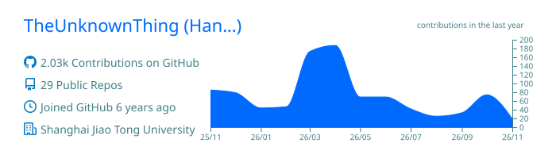
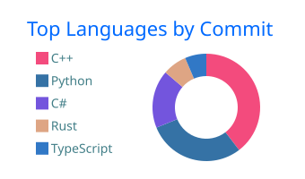
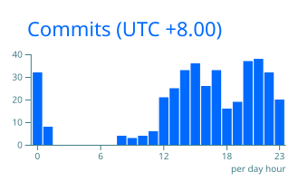

  <h1>
    Hi, I'm Hanning Wang
    
  </h1>

  

    <a href="https://acm.sjtu.edu.cn/~theunknownthing/">Homepage</a> ·
    <a href="https://acm.sjtu.edu.cn/~theunknownthing/cv/">CV</a> ·
    <a href="https://theunknownth.ing/">Blog</a> ·
    <a href="mailto:theunknownthing@sjtu.edu.cn">Email</a>
  

I'm an undergraduate in the [ACM Honors Class](https://acm.sjtu.edu.cn/) at **Shanghai Jiao Tong University** and a research intern at the [Shanghai Innovation Institute](https://sii.edu.cn/).

I work on pretraining data pipelines and efficient training infrastructure. I contributed to [**801-30B-A3B-Base**](https://github.com/GAIR-NLP/801-30B), check out our tech report!

Beyond research, I enjoy building network tools, photographing, and playing Slay the Spire. Visit my [blog](https://theunknownth.ing/) for more!

  <h3>📊 GitHub Analytics</h3>
  

    
  

  

    
    
  

